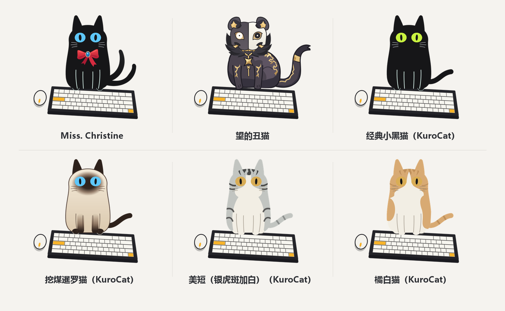
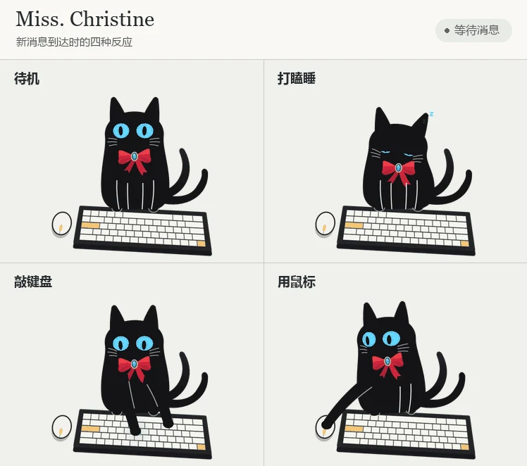

# ArkCats

ArkCats 是一款 Windows 桌宠，有六只猫和两只狐狸。首次启动是戴蓝宝石红领结的双尾黑猫 **Miss. Christine**。右键桌宠或点击托盘图标，打开 **「皮肤选择」** 即可切换。下次启动时会恢复上一次的选择。

| Miss. Christine | 望的丑猫 |
| :---: | :---: |
|  | [](assets/wang-go.webp) |

## 下载与启动

1. 从 [GitHub Releases 下载 ArkCats-Windows-x64.zip](https://github.com/astr-yuan/ArkCats/releases/latest/download/ArkCats-Windows-x64.zip)。
2. 完整解压到常用文件夹，让 `ArkCats.exe` 与 `ArkCatsNotifications.exe` 位于同一目录，双击 **`ArkCats.exe`**。
3. 拖动桌宠可以摆放位置。右键菜单可调整尺寸、设置鼠标穿透、开启通知反应和退出。皮肤共用这些设置。

## 皮肤与动作



| 菜单中的名称 | 外观与互动 |
| --- | --- |
| Miss. Christine | 两条黑尾、蓝眼黑瞳、红色蓝宝石领结。 |
| 望的丑猫 | 围棋棋盒化身。半黑半白的面具配反色瞳孔，颈前垂着金坠，前臂、脊背和长尾带有金纹。按回车或选择「演示落子」，它会伸爪，在小棋盘的交点上轮流落黑子和白子。 |
| 赤狐 | 正面坐姿，深色耳尖和前爪，橘白色块勾出轮廓。待机时轻动耳朵、慢眨眼，困倦时眼睛收成弧线。 |
| 北极狐 | 冷灰细线勾出白色耳尖和蓬尾。困倦时轻收前爪，低头合眼，睡着后微微呼吸。 |
| 经典小黑猫（KuroCat） | 亮绿眼、单尾的经典黑猫。 |
| 挖煤暹罗猫（KuroCat） | 蓝眼、深色面罩与四肢。 |
| 美短（银虎斑加白）（KuroCat） | 银灰虎斑与白色胸腹。 |
| 橘白猫（KuroCat） | 暖橘斑纹和白色胸腹。 |

六只猫都会追随光标、敲迷你键盘、在被轻抚时眯眼，闲置后打瞌睡。在菜单中选择「演示打字动画」可以直接预览敲键。同时按住三个支持的按键还可触发猫咪伸后脚的彩蛋。两只狐狸使用同一套键盘和鼠标。移动光标时，它们会转眼跟随。敲键时，它们会看向对应的键，保持坐姿伸出前爪。够远处的键或鼠标时，前腿会稍稍伸长，身体轻轻靠过去。

## Windows 通知反应

勾选 **「收到 Windows 通知时做出反应」**，并在 Windows 询问时允许通知访问。菜单显示「已就绪，等待新通知」后，任何应用在 Windows 通知中心新增一条通知，都可以让当前的桌宠受惊。桌宠会根据当时的待机、瞌睡、打字或鼠标状态做出反应。切换皮肤后，通知开关继续生效。

程序在本机比较通知编号与创建时间。开启前的旧通知会跳过，五秒内连续到达的通知合并为一次动作。全新安装时此功能默认关闭。需要重新授权时，可在 Windows 设置中允许通知访问，再点猫咪菜单里的「重新连接并检查通知权限」。

<details>
<summary>查看四种通知动作的同步演示</summary>



</details>

## 从旧版升级

已经在用 ArkCats 的用户可以从托盘退出程序，再将新版解压到原目录。启动后会恢复先前选择的皮肤、尺寸和位置。

先从托盘退出旧的 Miss. Christine 或望的丑猫，再启动 `ArkCats.exe`。ArkCats 首次运行时会读取旧版的通用偏好，包括位置、尺寸、键盘配色和通知开关。如果两个独立版都有设置，优先采用 Miss. Christine 的设置。首次显示 Miss. Christine，之后使用 ArkCats 自己保存的皮肤和偏好。

原来开启了开机启动的用户，如果将新版解压在同一个旧版目录，可在托盘菜单中选择「将此目录旧版的开机启动迁移到 ArkCats」。如果换了安装目录，可从原应用关闭开机启动，再从 ArkCats 开启。通知助手随应用改名，Windows 可能需要为它重新授权。

## 本地运行与构建

适用于 Windows 10（1607 及以上）和 Windows 11 x64。通知助手需要 .NET Framework 4.8 或 4.8.1。在 x64 MinGW-w64 环境或 Visual Studio 的 x64 本机工具命令提示符中，从仓库根目录执行：

```bat
cd windows
build.bat
```

构建产物为 `windows/ArkCats.exe` 和 `windows/ArkCatsNotifications.exe`。也支持 CMake 3.20 及以上版本。

ArkCats 使用 Windows Raw Input 接收键鼠活动，击键计数保存在内存中，退出时清空。按键气泡可以在菜单中关闭。完全鼠标穿透的默认快捷键是 `Ctrl + Alt + Shift + P`，也可以从托盘操作。

## 来源与许可

桌宠基于 chanke17 的 KuroCat，沿用 Win32 与 GDI+ 实时绘制。ArkCats 整合了 Miss. Christine、望的丑猫、赤狐、北极狐与四款 KuroCat 皮肤，并保留上游 MIT 版权声明。[KuroCat 上游源码](https://github.com/chanke17/KuroCat/tree/5fbe37930b07ad01f3c004eae47eaa4d1339ebfe) · [代码许可证](LICENSE)
